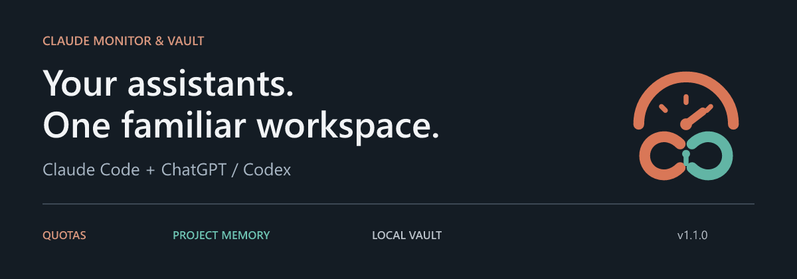
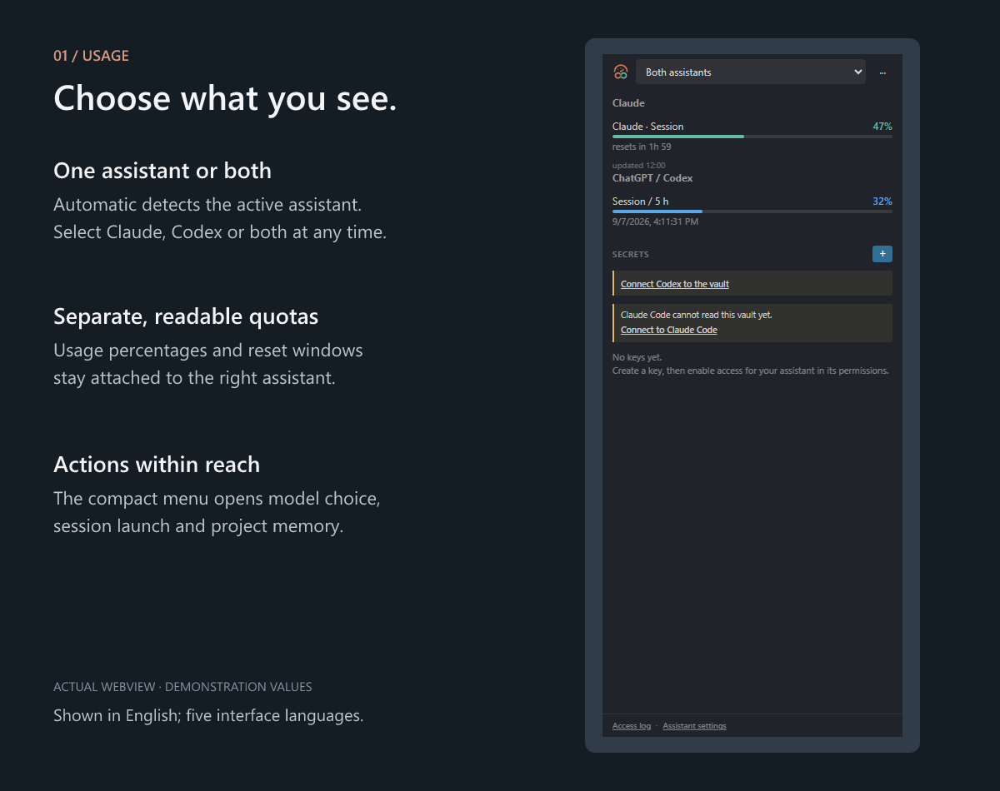
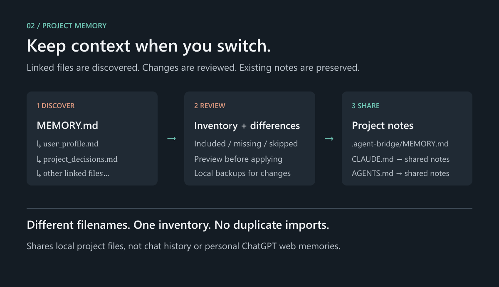

<p align="center">
  
</p>

# Claude Monitor & Vault + ChatGPT

**See your usage. Keep your project context. Control access to your secrets.**

Monitor Claude Code and ChatGPT / Codex quotas from one VS Code panel, choose an
assistant and model for your next session, and share project instructions through
local files. Your familiar Claude Monitor & Vault now includes optional Codex support.

[Install from Visual Studio Marketplace](https://marketplace.visualstudio.com/items?itemName=alexossart.claude-monitor-vault)
 · [User guide](docs/GUIDE.md) · [Release notes](CHANGELOG.md)
 · [Report an issue](https://github.com/DarkHenos/claude-monitor-vault/issues)

**Version 1.2.0** · VS Code 1.106+ · IntelliJ IDEA and other JetBrains IDEs 2023.1+
([beta](#intellij-idea-and-other-jetbrains-ides-beta)) · Windows, macOS and Linux ·
English, French, Spanish, German and Portuguese.

## One panel for your assistants



The quota selector controls what you see; the actions menu controls what you launch.

| Display mode | Behaviour |
|---|---|
| **Automatic** | Prefers the active assistant tab or terminal, then your saved choice, running terminals, active clients and project instructions. Ambiguous signals can show both. |
| **Claude** | Shows Claude usage counters. |
| **ChatGPT / Codex** | Starts Codex monitoring and shows the connected account's quota windows. |
| **Both assistants** | Shows Claude and Codex quotas together, with separate labels. |

The status bar and activity badge follow your selection. Open **···** for model
selection, session launch, shared memory and vault connection actions.

Both assistants share one quota renderer, so their rows look and behave the same:
a label from the window length (**Session (5h)**, **Week**, or hours and days),
the percentage and bar, a live **resets in 2 h 14** countdown refreshed every
minute (every 10 seconds near a reset), the optional projection, the 70% / 90%
levels and the same "updated / next update" footer. In **Both assistants** mode
the status bar and activity badge show both providers. Only the colour differs:
in **Assistant settings**, choose usage-based or custom Codex colours: normal
below 70%, warning from 70%, and critical from 90%. The settings page includes each displayed assistant's vault
connection and a dedicated Codex connection status.

*The panel image uses demonstration values. Codex counters describe the windows
returned for the connected account, not every limit on the ChatGPT website.*

## Get started

1. Install **Claude Monitor & Vault** from the Extensions view or run:

   ```sh
   code --install-extension alexossart.claude-monitor-vault
   ```

2. Open a local project and the **Claude Monitor** panel from its activity-bar icon.
3. Use your signed-in Claude Code installation. For Codex, install its CLI and
   sign in with `codex login`, then select **ChatGPT / Codex** or **Both assistants**.
4. To start another assistant, open **··· → Switch assistant / model**. Select a
   model, review the proposed memory changes, and launch the new session.

For a downloaded build, use **Extensions → ··· → Install from VSIX** and select
`claude-monitor-vault-1.2.0.vsix`.

## A pane beside the Claude Code chat

**vault-pane** is a Claude Code mod that shows the vault (key names only, groups,
MCP access) and the Claude quotas in a pane beside the chat, in the terminal, in
VS Code and in Claude Desktop. Install it at the prompt of a Claude Code session:

```
/plugin install vault-pane --marketplace DarkHenos/claude-monitor-vault
```

In Claude Desktop: **+** next to the prompt box, **Plugins**, **Add marketplace**
with `DarkHenos/claude-monitor-vault`, then **Add plugin**. Details in
[vault-pane/README.md](vault-pane/README.md).

## Bring project knowledge to the next session



Import `CLAUDE.md`, `AGENTS.md`, or a memory index such as `MEMORY.md`. The extension
follows linked Markdown files, even when they have different names, and counts
each file once. Before applying, you see included files, missing references,
skipped paths and the proposed changes.

Both assistants receive a reference to **`.agent-bridge/MEMORY.md`**. Imports keep
separate snapshots and preserve their links. Existing notes are retained, and
modified files are backed up locally. Repeating an unchanged import adds no duplicates.

**You remain in control:** memory imports are reviewed before writing files.
It does not merge contradictory instructions, transfer conversation history, or
import personal memories from ChatGPT on the web. Model selection starts a new
CLI session; existing chats retain their own model.

When Codex is detected in a trusted project, basic setup runs automatically:
shared-memory references, vault instructions in `AGENTS.md`, and the local MCP
connection in `.codex/config.toml`. Existing files are preserved and backed up;
unsaved edits or conflicting managed blocks stop setup. Importing other memory
files remains a separate, reviewed action. Start a new Codex session after the
initial setup so it can load the context and tools.

[Read about linked memories, backups and restoration](docs/GUIDE.md#switch-assistants-without-losing-project-knowledge).

## Keep secrets in a local vault

Store keys in an encrypted local vault and grant access to selected tools.
The panel shows key names and policies. Claude uses markers; the Codex connection
provides local MCP tools for listing permitted metadata and running a program
with selected keys in its environment.

By default, Codex can use the same keys as Claude, including newly created keys,
without enabling MCP one key at a time. Expiry, use limits, confirmation and
named-server restrictions still apply. Select **Only MCP-authorized keys** in
**Assistant settings** for stricter access. This setting does not alter existing
key permissions. Restart existing Codex sessions after changing the connection
or access mode. A deliberate disconnection is not automatically undone.

| Capability | Claude Code | ChatGPT / Codex |
|---|---|---|
| Usage monitoring | Session, weekly and model counters | Account quota windows returned by Codex |
| New-session model choice | Default, Sonnet, Opus, Haiku or model ID | Available model catalog, default or model ID |
| Shared project notes | Reference from `CLAUDE.md` | Reference from `AGENTS.md` |
| Local vault access | Hooks, markers and MCP proxy | `vault_list` and `vault_run` through a project MCP connection |
| Create keys and decide MCP | `add.js` with `--mcp`, `--mcp=SERVERS`, `--no-mcp`, `--group` | `vault_create` |
| Change MCP access or groups | `set.js` | `vault_set` and `vault_layout` |

Expiry, optional per-use confirmation, an access log, encrypted backups and
recovery tools are available. Output redaction is best effort; a program receiving
a secret can still transform or disclose it.

### Groups and separators

Arrange keys like folders in a sidebar. Groups exist empty or filled, fold and
unfold, and keep their order; separators split the list, with or without a small
title. Drag keys, groups and separators to reorder them, or use **Move up** and
**Move down** from the menus. Search matches names, groups and descriptions.
**Suggest groups** proposes groups from shared prefixes (rotation suffixes such
as `_2026_10` removed, environments such as `DEV` and `PROD` kept, near spellings
flagged) and applies nothing until you confirm. A group menu can allow or remove
MCP access for every key in it, with Undo on removal. Groups only change where a
key sits in the list, never what it can do, and they travel with export and import.

### The AI decides MCP, within your rules

When Claude or ChatGPT creates a key, it says what the key may do: shell only,
named MCP servers, or every server. Claude uses `add.js`; ChatGPT uses
`vault_create`, which runs a program and stores its output without ever returning
the value. A value already stored under another name is refused. Later changes go
through `set.js` (Claude) or `vault_set` and `vault_layout` (ChatGPT):

```sh
node set.js STRIPE_SECRET_KEY --mcp=stripe --reason "the Stripe MCP server needs it"
node set.js STRIPE_SECRET_KEY STRIPE_WEBHOOK_SECRET --group "Stripe"
node set.js --new-group "Scaleway" --at 1
```

Placing keys and reorganising apply at once, and removing or narrowing MCP access
always applies at once. Granting or widening follows **What the AI may do**, a new
card in the vault settings window:

| MCP access | Behaviour |
|---|---|
| **Off** | The AI never changes MCP access. |
| **Ask** (default) | The AI may remove access, and grant it at creation for named local servers. Anything else opens one VS Code window: who asks, keys, servers and the AI's reason, with **Allow**, **Choose servers** or **Refuse**. |
| **Automatic** | The AI grants and removes on its own, except for keys that ask before every use, grants to every server and grants to remote servers, which still ask. Turning it on asks for confirmation. |

The same card controls whether the AI may organise keys into groups and whether
it may replace keys without asking, with an optional override per assistant.
Every change is written to the access log with its author (Claude, ChatGPT or
you), and a change made by the AI shows briefly in the status bar.

[Explore vault setup, recovery and security boundaries](docs/GUIDE.md#claude-vault).

## A familiar extension, updated

Version **1.2.0** adds groups and separators in the vault, MCP access decided by
the AI under a setting you control, `set.js` for Claude and the `vault_create`,
`vault_set` and `vault_layout` tools for ChatGPT, and ChatGPT quota rows aligned
with Claude's. Version 1.1.0 brought the unified quota selector, assistant and
model switching, linked project memories, Codex vault tools and the
gauge-and-link logo.
The Marketplace identifier remains **`alexossart.claude-monitor-vault`**; existing
Claude settings, command IDs and encrypted vault files stay in place.

A **What's New** tab explains the update once per version. Reopen it from the
command palette, or choose a notification instead in the settings.

| Setting | Purpose |
|---|---|
| `agentBridge.quotaDisplay` | `auto`, `claude`, `codex` or `both` |
| `agentBridge.syncOnSwitch` | Propose memory synchronization when changing assistants |
| `agentBridge.codexAutoSetup` | Automatically prepare context and the vault connection in trusted projects |
| `agentBridge.codexVaultAccess` | `claude` for Claude-equivalent access, or `mcp` for explicitly authorized keys |
| `agentBridge.updateNotice` | Update tab (`window`), `notification` or `off` |
| `agentBridge.codexExecutable` | Optional absolute path to the Codex executable |
| `claudeLimits.location` | Main or secondary sidebar |
| `claudeLimits.alerts` | Claude quota notifications |

## IntelliJ IDEA and other JetBrains IDEs (beta)

Version 1.2.0 also runs in IntelliJ IDEA, WebStorm, PyCharm and the other
JetBrains IDEs, from 2023.1 onwards. This support is a **beta**.

It is the same extension, not a port: a small JetBrains plugin starts the
extension's own files on Node.js and draws what they ask for with the IDE's
components. The panel, the vault, the Claude Code connection and the ChatGPT /
Codex features are the code VS Code runs. The vault is the same one
(`~/.claude/vault`): a key created in one editor is there in the other.

- **Requirements:** Node.js 18 or later, found on `PATH` or chosen in
  *Settings > Tools > Claude Monitor & Vault*, and an IDE with JCEF (the default).
- **Install:** *Settings > Plugins > ⚙ > Install Plugin from Disk*, then choose
  `claude-monitor-vault-1.2.0.zip`. The plugin is not on JetBrains Marketplace yet.
- **Where things are:** the panel is the *Claude Monitor* tool window on the
  right, the usage figures are in the status bar, the commands are in
  *Tools > Claude Monitor & Vault* and in *Find Action* (Ctrl+Shift+A), and the
  settings are in *Settings > Tools > Claude Monitor & Vault*.
- **Differences from VS Code:** no activity bar badge (the figures appear in the
  tool window title and the status bar), and no side bar commands, since a tool
  window is moved by dragging it. Memory previews open in the IDE's diff viewer.
- **Both editors on one machine:** keep them on the same version. Each one keeps
  the Claude Code connection in step with its own files.

Building it is described in [intellij/README.md](intellij/README.md).

## Requirements and support

- **Local CLIs:** Claude Code and/or Codex must be installed and signed in on the
  host running the extension. API-key-only Codex accounts may not return subscription quotas.
- **Workspace trust:** vault access, Codex and memory synchronization require a
  trusted local project. Claude quota viewing remains available in restricted mode.
- **Remote projects:** in Remote/WSL, the CLIs and vault belong to the extension
  host. Browser-only VS Code and virtual workspaces are not supported.
- **Implementation:** plain JavaScript with no packaged runtime npm dependencies.

For troubleshooting, use the assistant diagnostics command and include your
extension version, operating system and reproduction steps in an
[issue](https://github.com/DarkHenos/claude-monitor-vault/issues).

[Full user guide](docs/GUIDE.md) · [Changelog](CHANGELOG.md) · [MIT license](LICENSE)
